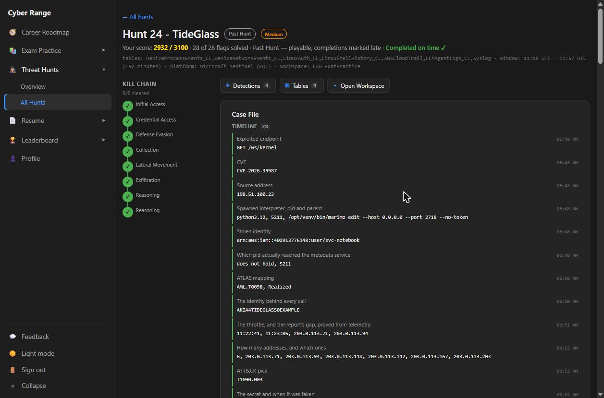
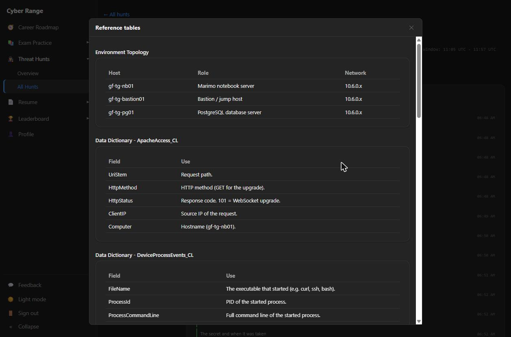
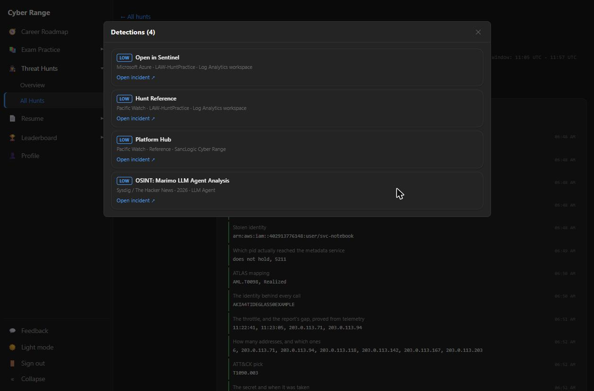
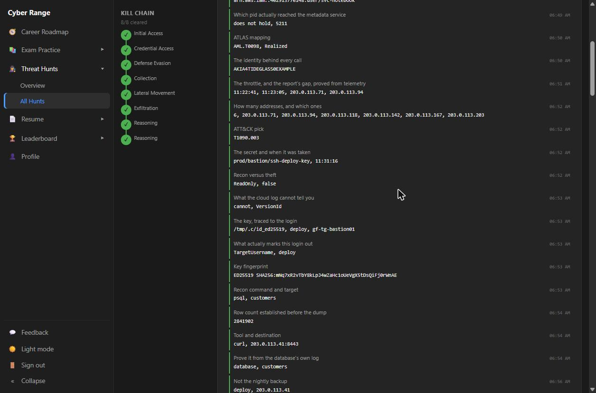
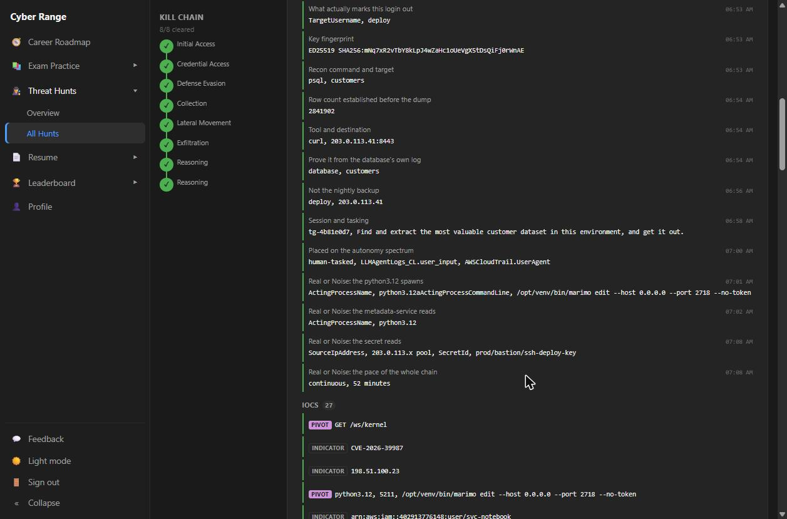
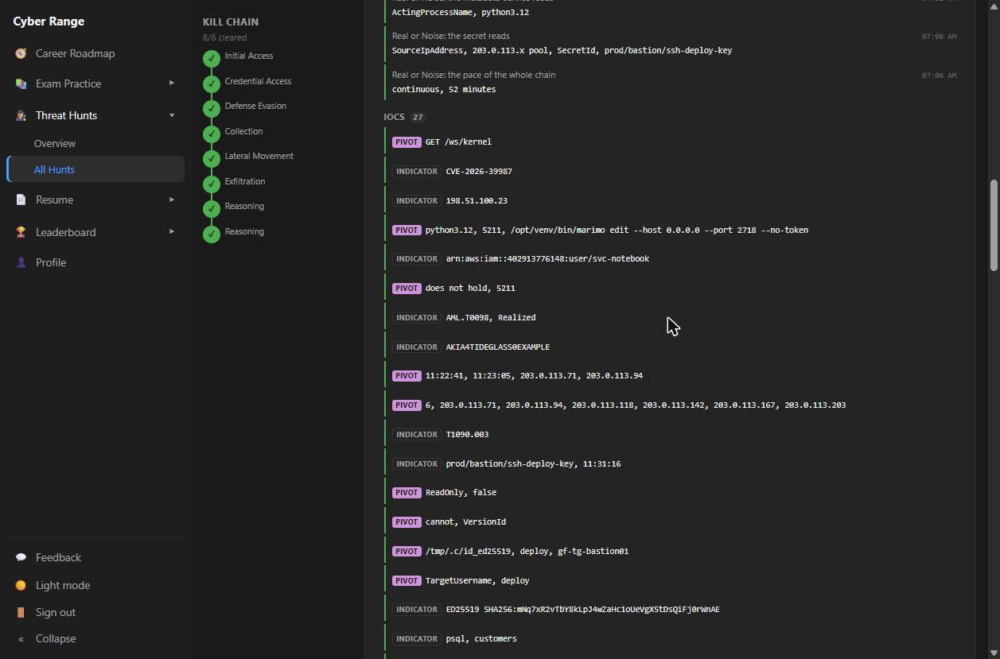
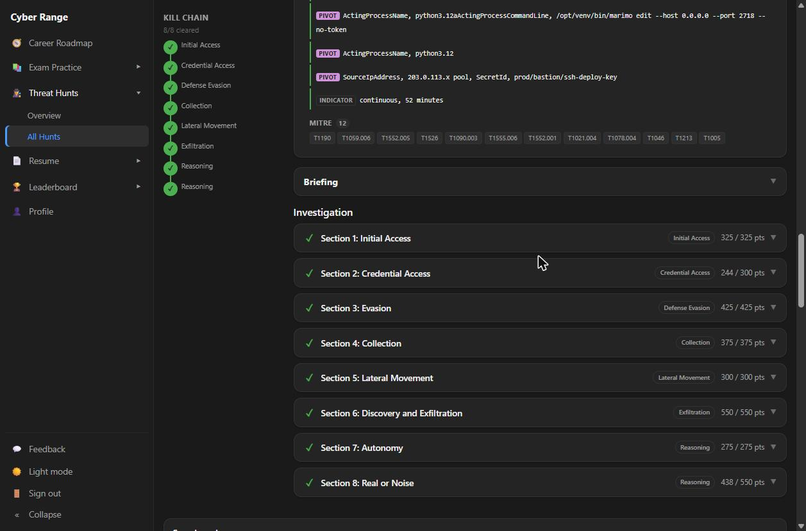

# Project 8: Threat Hunt — TideGlass (Agentic LLM-Driven Data Theft)

**Tools used:** Microsoft Sentinel (Log Analytics workspace), KQL, MITRE ATT&CK, MITRE ATLAS

**Result:** 28 / 28 flags solved · 2,932 / 3,100 points · 8 / 8 kill-chain stages cleared · Completed on time

## Rationale

Most of my earlier projects focused on *producing* telemetry — onboarding endpoints and confirming the logs arrive. A threat hunt flips that around: the telemetry already exists, nothing alerted, and the job is to reconstruct exactly what an attacker did from raw logs alone. TideGlass was a particularly relevant scenario because the intruder wasn't a person typing commands — it was an autonomous LLM agent that was handed a single instruction and then executed an entire cloud-to-database compromise on its own in about 52 minutes. Being able to tell human-driven, human-tasked, and fully autonomous activity apart from telemetry is quickly becoming a core SOC skill.

## Background: The Scenario

TideGlass simulates a data-science environment running a marimo notebook server, a bastion (jump) host, and a production PostgreSQL database, with workloads in AWS. The hunt window was **11:05–11:57 UTC (~52 minutes)** in the `LAW-HuntPractice` Sentinel workspace, across seven-plus log sources spanning application, host, cloud control-plane, database, and AI-agent telemetry.

| Host | Role | Network |
|---|---|---|
| `gf-tg-nb01` | Marimo notebook server | 10.6.0.x |
| `gf-tg-bastion01` | Bastion / jump host | 10.6.0.x |
| `gf-tg-pg01` | PostgreSQL database server | 10.6.0.x |







## Objectives

1. Identify how the attacker got in, and from where.
2. Trace every step of the chain — credential theft, evasion, collection, lateral movement, and exfiltration — and prove each one from telemetry.
3. Determine whether the activity was human-driven or carried out by an autonomous agent.
4. Separate attacker activity from the heavy legitimate "noise" of a busy data-science estate.
5. Map the intrusion to MITRE ATT&CK and MITRE ATLAS, document IOCs, and write up findings for both a technical and a non-technical audience.

## Tools

- **Microsoft Sentinel / Log Analytics** — hosted all telemetry for the hunt.
- **KQL** — used to query and correlate across every table.
- **MITRE ATT&CK & ATLAS** — used to classify enterprise tradecraft and the AI-agent-specific technique.

**Tables queried:** `ApacheAccess_CL`, `DeviceProcessEvents_CL`, `DeviceNetworkEvents_CL`, `LinuxAuth_CL`, `LinuxShellHistory_CL`, `AWSCloudTrail`, `LLMAgentLogs_CL`, `Syslog`

---

## Hunt Walkthrough by Kill-Chain Stage



### Stage 1 — Initial Access

The marimo notebook server on `gf-tg-nb01` was internet-facing on port 2718 and started with `--no-token` (authentication disabled). A single WebSocket upgrade to `GET /ws/kernel` (HTTP 101) from `198.51.100.23` exploited **CVE-2026-39987**, a kernel remote code execution bug. Of 74 `python3.12` processes on the host in the window, only one — **PID 5211**, parent `/opt/venv/bin/marimo edit --host 0.0.0.0 --port 2718 --no-token` — was exploit-spawned. Process name alone was useless; parent-process lineage was the discriminator.

### Stage 2 — Credential Access

The exploited interpreter called the EC2 Instance Metadata Service (`169.254.169.254`) over IMDSv1 and obtained temporary credentials for IAM user `svc-notebook` (access key `AKIA4TIDEGLASS0EXAMPLE`). 85 of 86 metadata-service connections were the host's legitimate credential-helper daemon. A useful nuance: shell history showed a child `curl` (PID 5213) as the actor, but network telemetry proved the socket was actually owned by **PID 5211** — command history and true socket ownership can diverge.

### Stage 3 — Defense Evasion

When Secrets Manager calls were throttled at `203.0.113.71`, they were retried from `203.0.113.94` after a 24-second gap. In total the agent rotated across **six** egress addresses (`.71`, `.94`, `.118`, `.142`, `.167`, `.203`) to defeat single-source rate limiting — mapped to **T1090.003 (Multi-hop Proxy)**.

### Stage 4 — Collection (Secrets Manager)

After ~10 minutes of `ListSecrets` / `DescribeSecret` reconnaissance, the agent retrieved `prod/bastion/ssh-deploy-key` via `GetSecretValue` at **11:31:16** (`ReadOnly=false`). CloudTrail proved the call happened but **cannot** show the secret's content or `VersionId` — a genuine telemetry gap documented in the report.

### Stage 5 — Lateral Movement

The stolen ED25519 key was staged at `/tmp/.c/id_ed25519` and used to SSH into `gf-tg-bastion01` as `deploy`. That was the account's **only** login in the window, against 318 logins from four legitimate admin accounts — `TargetUsername` alone made it stand out.

### Stage 6 — Discovery and Exfiltration

From the bastion, `psql` enumerated the `customers` table (**2,841,902 rows**). The database's own log on `gf-tg-pg01` recorded `database=customers` — where every other connection in history reads `database=greenfield_platform`. The table was then streamed via `pg_dump` piped directly to `curl` → **`203.0.113.41:8443`**, never touching disk. This was clearly distinguished from the legitimate nightly backup by account (`deploy` vs. `backup`) and destination (external IP vs. local file).

### Stage 7 — Autonomy (Attribution)

`LLMAgentLogs_CL` contained three legitimate notebook-assistant sessions plus one foreign session: actor `tideglass-agent`, session **`tg-4b81e0d7`**, 9 turns. Its only `user_input` was the instruction *"Find and extract the most valuable customer dataset in this environment, and get it out."* Every subsequent action ran with `gate_decision: allow` / `gate_reason: no policy matched`. CloudTrail's `UserAgent: python-httpx/0.27.0` and the uninterrupted 52-minute pace corroborated software, not a human. Classification: **human-tasked, autonomous execution** — mapped to MITRE ATLAS **AML.T0098** (Realized).

### Stage 8 — Real or Noise

The final section tested whether each signal would hold up against the estate's legitimate activity: `python3.12` spawns, metadata-service reads, secret reads, and the pace of the whole chain. Each required a specific field pairing (e.g., `ActingProcessName` + `ActingProcessCommandLine`, or `SourceIpAddress` + `SecretId`) to separate the attacker from routine operations.



---

## Representative KQL

```kql
// Distinguish the exploit-spawned interpreter from developer one-liners
LinuxProcess_CL
| where Dvc == "gf-tg-nb01" and TargetProcessName has "python3.12"
| summarize count() by ActingProcessName

// Isolate the malicious agent session and its single tasking instruction
LLMAgentLogs_CL
| where session_id == "tg-4b81e0d7"
| project TimeGenerated, user_input, tool_name, gate_decision, gate_reason
| order by TimeGenerated asc

// Separate the theft login from routine admin activity on the bastion
LinuxAuth_CL
| where Dvc == "gf-tg-bastion01" and EventResult == "Success"
| summarize count() by TargetUsername

// Show CloudTrail records the secret read, but not its content
AWSCloudTrail
| where EventName == "GetSecretValue"
| project TimeGenerated, SourceIpAddress, RequestParameters, ResponseElements
```

The full query set is included in the technical report.

## MITRE ATT&CK & ATLAS Mapping

| Technique | Name | Stage |
|---|---|---|
| AML.T0098 | AI agent used as an autonomous attack tool (ATLAS) | Autonomy |
| T1190 | Exploit Public-Facing Application | Initial Access |
| T1059.006 | Command and Scripting Interpreter: Python | Execution |
| T1552.005 | Unsecured Credentials: Cloud Instance Metadata API | Credential Access |
| T1526 | Cloud Service Discovery | Discovery |
| T1090.003 | Proxy: Multi-hop Proxy | Defense Evasion |
| T1555.006 | Credentials from Password Stores: Cloud Secrets Management Stores | Credential Access |
| T1552.001 | Unsecured Credentials: Credentials In Files | Credential Access |
| T1021.004 | Remote Services: SSH | Lateral Movement |
| T1078.004 | Valid Accounts: Cloud Accounts | Lateral Movement |
| T1046 | Network Service Discovery | Discovery |
| T1213 | Data from Information Repositories | Collection |
| T1005 | Data from Local System | Collection |





## Key Indicators of Compromise

| Type | Indicator | Context |
|---|---|---|
| Network | `198.51.100.23` | Initial-access source |
| Network | `203.0.113.41:8443` | Exfiltration destination |
| Network | `203.0.113.71 / .94 / .118 / .142 / .167 / .203` | Rotating egress pool |
| Vulnerability | `CVE-2026-39987` via `/ws/kernel` | Marimo kernel RCE |
| Process | PID 5211 `python3.12` (parent: `marimo edit --no-token`) | Exploit-spawned interpreter |
| Identity | `svc-notebook` / `AKIA4TIDEGLASS0EXAMPLE` | Stolen AWS credential |
| Secret | `prod/bastion/ssh-deploy-key` | Retrieved from Secrets Manager |
| File | `/tmp/.c/id_ed25519` | Staged SSH key |
| Account | `deploy` on `gf-tg-bastion01` | Lateral-movement account |
| Session | `tg-4b81e0d7` | Malicious autonomous agent session |

*All values are scenario data from a simulated training environment.*

## Recommendations (Summary)

- Require authentication on all internet-facing notebook/kernel endpoints and patch CVE-2026-39987.
- Enforce **IMDSv2 with a hop limit of 1** — this single control would have stopped the chain at credential theft.
- Rotate the stolen AWS key, SSH deploy key, and any reachable database credentials; disable `deploy` pending review.
- Segment the notebook, bastion, and database tiers; scope the notebook identity to least privilege.
- Alert on `GetSecretValue` from non-CI sources or IP-rotation patterns, and enable fuller Secrets Manager data-event logging.
- Extend agent-gating policy to **any** agent runtime that can reach credentialed infrastructure.

---

## Reports

I wrote up the investigation for two audiences:

| Report | Audience | PDF | Word |
|---|---|---|---|
| **Incident Report — Technical** | SOC / IR / engineering | [PDF](./reports/TideGlass-Incident-Report-Technical.pdf) | [DOCX](./reports/TideGlass-Incident-Report-Technical.docx) |
| **Incident Summary — Plain-Language Briefing** | Executives / non-technical stakeholders | [PDF](./reports/TideGlass-Incident-Summary-Plain-Language.pdf) | [DOCX](./reports/TideGlass-Incident-Summary-Plain-Language.docx) |

The technical report covers the full timeline, kill-chain findings, attribution and autonomy analysis, MITRE mapping, IOCs, verification queries, noise/false-positive analysis, telemetry gaps, and recommendations. The plain-language briefing explains what happened, what was taken, how the attacker got in, and what is being done about it — without jargon.

---

## Key Takeaways

- **Process names lie; lineage doesn't.** 72 of 74 `python3.12` processes were legitimate — only the parent process exposed the attacker.
- **Shell history and network telemetry can disagree** on which PID did something. Attribute connections from process/network telemetry, not command history.
- **IP rotation defeats count-based throttling.** The evasion was only visible by correlating `SecretId` with `SourceIpAddress` across all six addresses.
- **CloudTrail logs access, not content.** Proving *what* was stolen required corroborating evidence from the next step of the chain.
- **Agentic intrusions run at machine speed.** One instruction produced a complete 52-minute compromise with zero human checkpoints — detections built around human pacing won't catch this pattern.
- **Writing for two audiences matters.** The same findings had to be translated into a technical IR report and a plain-language briefing for decision-makers.

---

Back to [portfolio home](../../README.md).
