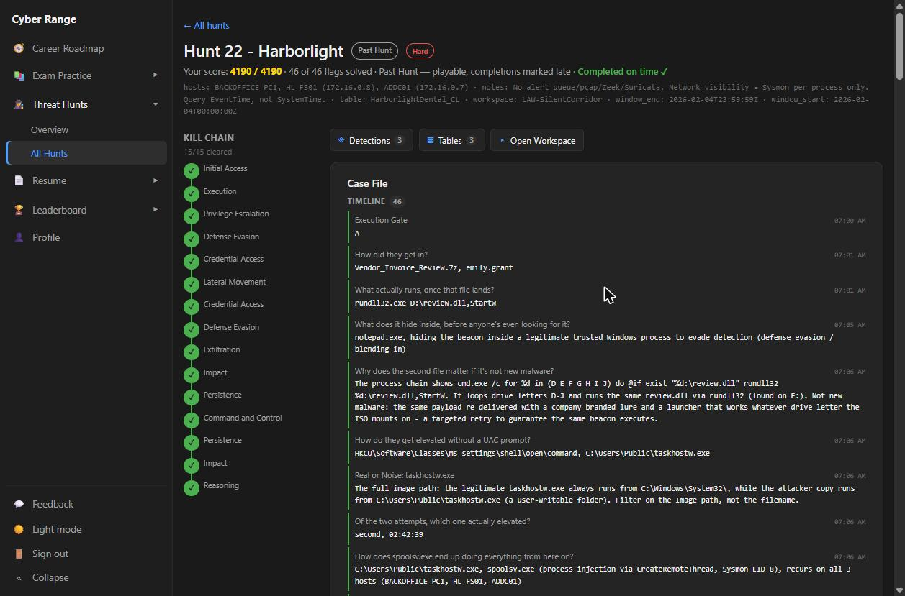
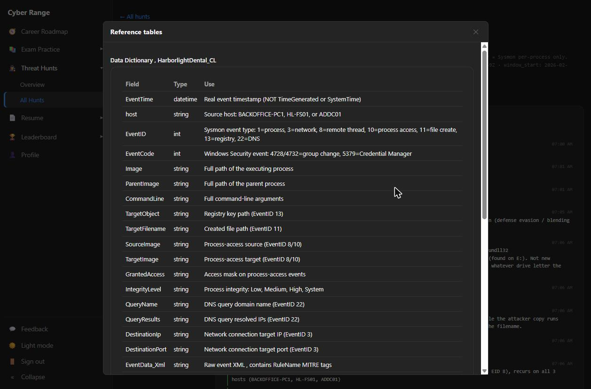
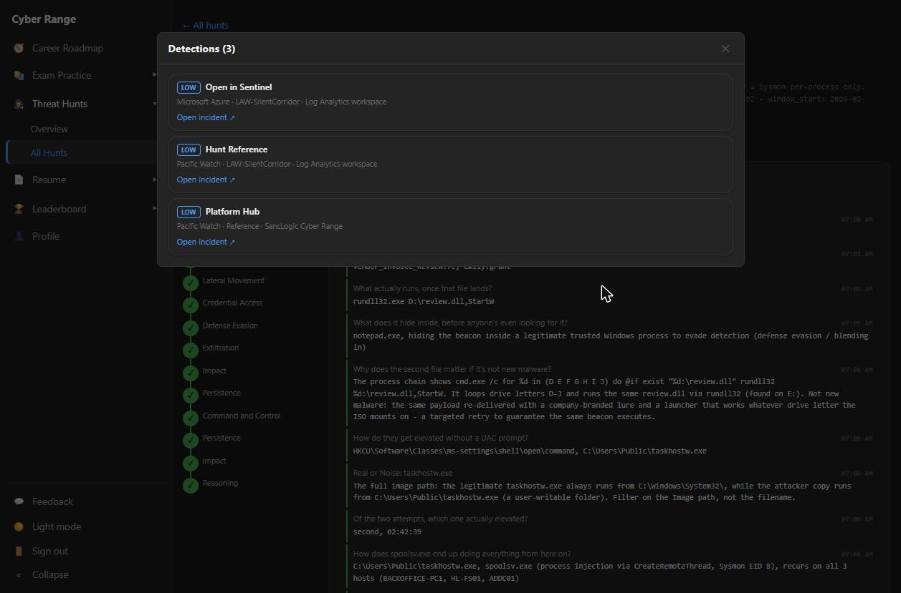
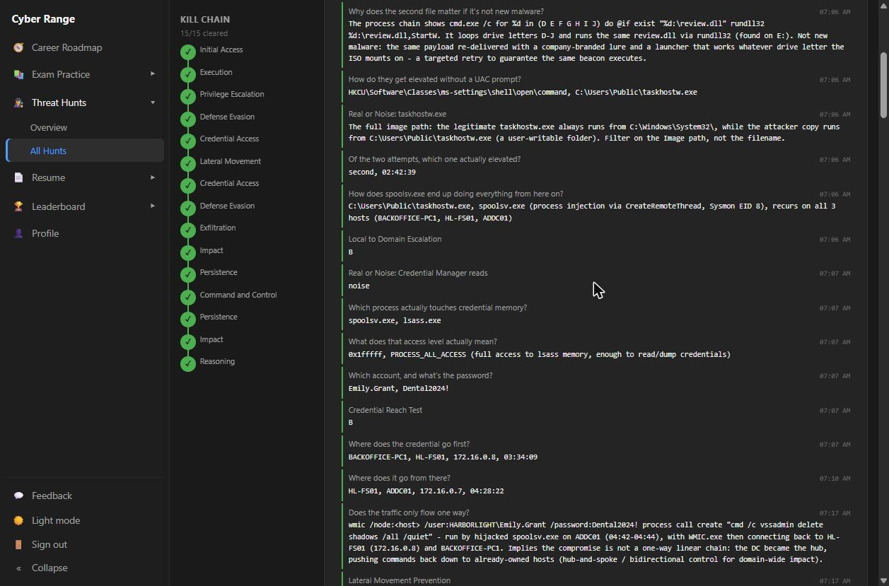
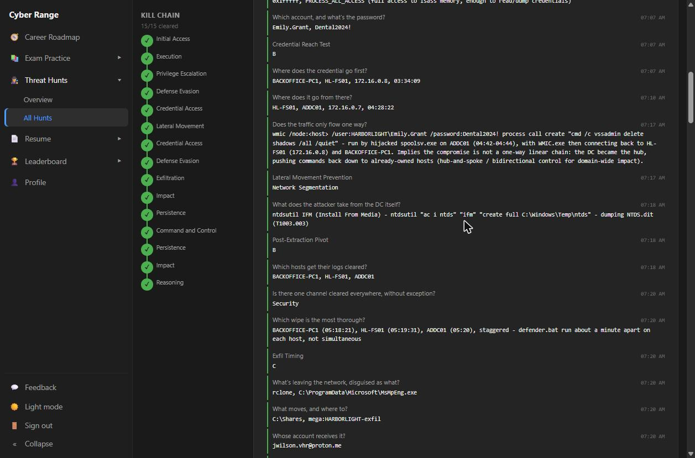
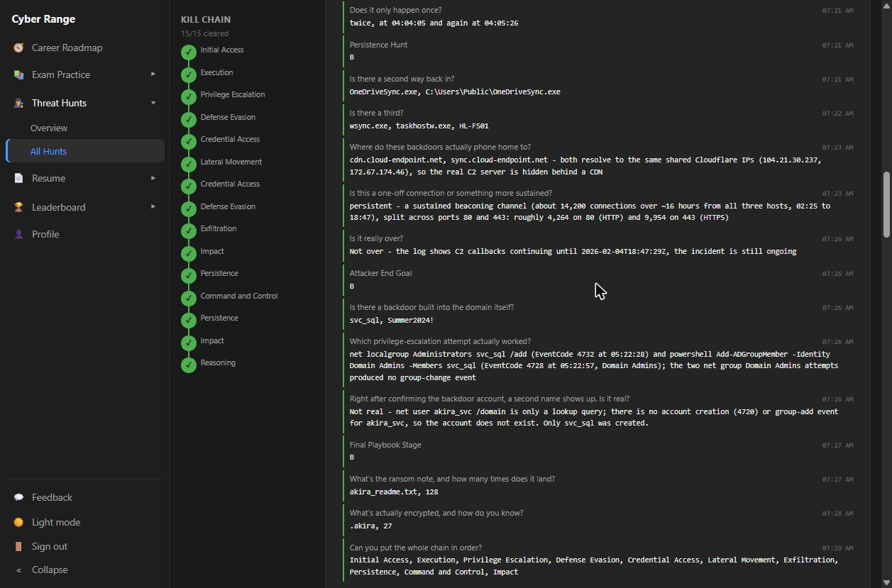
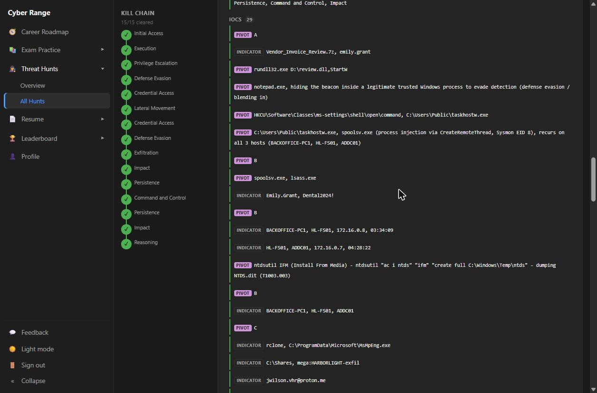
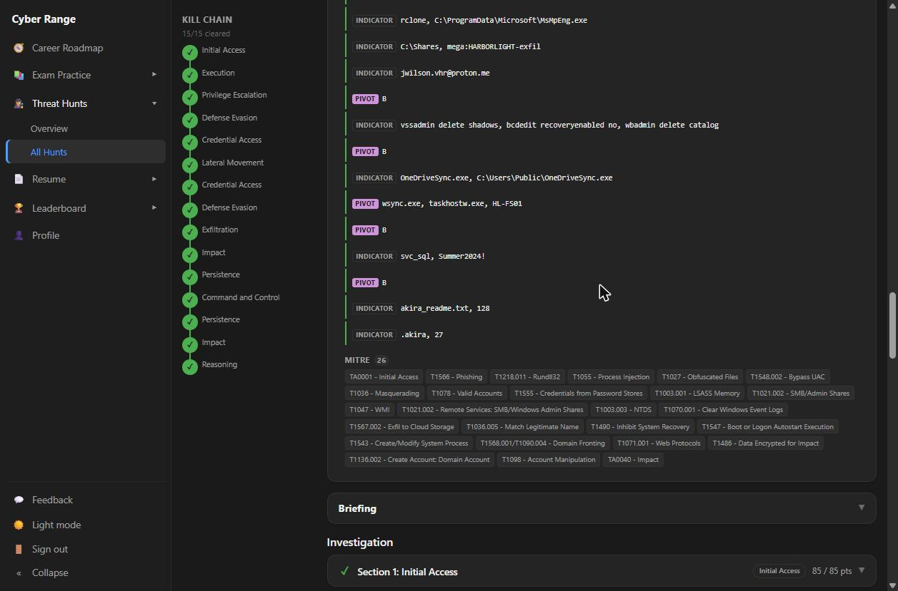
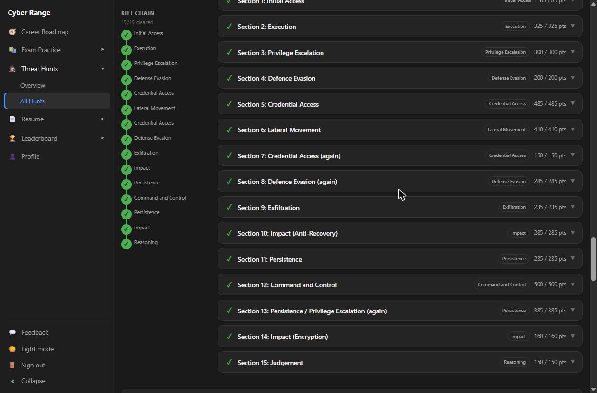

# Project 9: Threat Hunt — Harborlight (Akira-Style Ransomware, Full Domain Compromise)

**Tools used:** Microsoft Sentinel (Log Analytics workspace), KQL, Sysmon, Windows Security Event Logs, MITRE ATT&CK

**Result:** 46 / 46 flags solved · 4,190 / 4,190 points (perfect score) · 15 / 15 kill-chain stages cleared · Hard difficulty · Completed on time

## Rationale

TideGlass ([Project 8](../08-threat-hunt-tideglass/README.md)) was a cloud and AI-agent intrusion. Harborlight is the classic small-business nightmare: a dental and insurance practice with a five-person MSP, no SOC and no alert queue, where staff found ransom notes one morning and reported it cold. Every step of the attack was sitting in Sysmon and Windows Security logs that nobody had reviewed. The job was to rebuild the entire intrusion host by host, from the first click to encryption, and to decide at each step whether something was the attacker, background noise, or the MSP's own tooling. It is also a lesson in not stopping early: the loud part (encryption) was not the end of the incident.

## Background: The Scenario

**Client:** Harborlight Dental & Insurance (case `HL-INC-2026-0204`), with IT handled by a five-person MSP and no SOC.
**Telemetry:** `HarborlightDental_CL` in the `LAW-SilentCorridor` workspace. This is Sysmon plus Windows Security only, with no PCAP, Zeek or Suricata, so network visibility is Sysmon per-process only.
**Window:** 4 February 2026, 00:00–23:59 UTC (queried on `EventTime`. `TimeGenerated` is ingestion time and `SystemTime` is often blank).
**Network:** Flat 172.16.0.0/24 with no segmentation.

| Host | Role | IP |
|---|---|---|
| `BACKOFFICE-PC1` | Front-office workstation (user Emily.Grant) | — |
| `HL-FS01` | File server | 172.16.0.8 |
| `ADDC01` | Domain controller | 172.16.0.7 |







## Objectives

1. Reconstruct the full intrusion from raw telemetry with no alert to start from.
2. Prove each kill-chain stage on each host, including the stages the attacker revisited (Credential Access, Defense Evasion and Persistence each occur twice).
3. Separate attacker activity from background noise and legitimate MSP tooling.
4. Determine whether the incident was actually over.
5. Map the chain to MITRE ATT&CK and report findings to both technical and non-technical audiences.

---

## Hunt Walkthrough by Kill-Chain Stage

### Initial Access and Execution
Emily.Grant opened **`Vendor_Invoice_Review.7z`**. The payload ran as **`rundll32.exe D:\review.dll,StartW`** (T1218.011). A second, company-branded lure was not new malware. It re-ran the same DLL through a drive-letter loop (`for %d in (D E F G H I J) do @if exist "%d:\review.dll" rundll32 ...`), so the beacon would execute wherever the image mounted (it landed on E:).

### Defense Evasion: Process Injection
The beacon hid inside **`notepad.exe`**. After elevation, the attacker's `C:\Users\Public\taskhostw.exe` injected into **`spoolsv.exe`** via CreateRemoteThread (Sysmon EID 8). From then on the Print Spooler ran the operation on **all three hosts**.

### Privilege Escalation: UAC Bypass
A registry hijack of `HKCU\Software\Classes\ms-settings\shell\open\command` pointed at `C:\Users\Public\taskhostw.exe` (T1548.002). Only the **second attempt (02:42:39)** elevated.
*Real or noise:* the legitimate `taskhostw.exe` always runs from `C:\Windows\System32\`, so the filter is on the full `Image` path, not the filename.

### Credential Access: LSASS
`spoolsv.exe` opened `lsass.exe` with **`0x1fffff` (PROCESS_ALL_ACCESS)** and recovered **Emily.Grant / Dental2024!** (T1003.001). The Credential Manager reads (EventCode 5379) in the same window were **noise**.



### Lateral Movement: Hub-and-Spoke
Emily.Grant's credential reached **HL-FS01 at 03:34:09** and **ADDC01 at 04:28:22**. Movement was not one-way: between 04:42 and 04:44, hijacked `spoolsv.exe` on the DC ran `wmic /node:<host> /user:HARBORLIGHT\Emily.Grant ... "cmd /c vssadmin delete shadows /all /quiet"` back against HL-FS01 and BACKOFFICE-PC1. The DC became the command hub. The control that would have stopped this is **network segmentation**.

### Credential Access (again): NTDS.dit
`ntdsutil "ac i ntds" "ifm" "create full C:\Windows\Temp\ntds"` dumped the full Active Directory database (T1003.003).

### Defense Evasion (again): Log Clearing
`defender.bat` cleared logs on all three hosts in sequence, about a minute apart: BACKOFFICE-PC1 (05:18:21), HL-FS01 (05:19:31) and ADDC01 (05:20). **Security** was the one channel cleared everywhere.

### Exfiltration
**`rclone`**, renamed **`C:\ProgramData\Microsoft\MsMpEng.exe`** to pose as Defender, copied `C:\Shares` to **`mega:HARBORLIGHT-exfil`**, an account registered to `jwilson.vhr@proton.me` (T1567.002).



### Impact: Anti-Recovery
HL-FS01 got the full treatment, **twice (04:04:05 and 04:05:26)**: `vssadmin delete shadows`, `bcdedit recoveryenabled no` + `bootstatuspolicy ignoreallfailures`, and `wbadmin delete catalog` (T1490). ADDC01 got only shadow-copy deletion.

### Persistence and Command and Control
There were three ways back in: `taskhostw.exe`, `C:\Users\Public\OneDriveSync.exe`, and `wsync.exe` on HL-FS01. C2 went to `cdn.cloud-endpoint.net` and `sync.cloud-endpoint.net`, both resolving to shared **Cloudflare** IPs (104.21.30.237, 172.67.174.46), which hid the real server behind a CDN. The beaconing was sustained at **~14,200 connections from all three hosts, 02:25–18:47** (~4,264 on port 80, ~9,954 on 443).
**Is it over? No.** Callbacks were still occurring at **2026-02-04T18:47:29Z**.

### Persistence / Privilege Escalation (again): Domain Backdoor
The attacker created **`svc_sql` / `Summer2024!`** and added it to local Administrators (4732, 05:22:28) and **Domain Admins** (4728, 05:22:57). Two `net group "Domain Admins"` attempts left no group-change event, so they failed.
*Real or noise:* `akira_svc` appears only in a `net user /domain` lookup, with no 4720 creation event, so **it does not exist**.

### Impact: Encryption
**`akira_readme.txt` was written 128 times**, and **27 files were encrypted with `.akira`**.



---

## Representative KQL

```kql
// Real or noise: taskhostw.exe running outside System32
HarborlightDental_CL
| where EventID == 1 and Image endswith "taskhostw.exe"
| summarize count() by Image, host

// Process injection and LSASS access by the hijacked Print Spooler
HarborlightDental_CL
| where EventID in (8, 10) and SourceImage endswith "spoolsv.exe"
| project EventTime, host, EventID, SourceImage, TargetImage, GrantedAccess

// Everything the hijacked spoolsv.exe launched
HarborlightDental_CL
| where EventID == 1 and ParentImage endswith "spoolsv.exe"
| project EventTime, host, Image, CommandLine
| order by EventTime asc

// C2 beacon volume and duration by port
HarborlightDental_CL
| where EventID == 3 and DestinationIp in ("104.21.30.237", "172.67.174.46")
| summarize count(), min(EventTime), max(EventTime) by DestinationPort

// Group changes that actually succeeded
HarborlightDental_CL
| where EventCode in (4728, 4732)
| project EventTime, host, EventCode, EventData_Xml
```

## MITRE ATT&CK Mapping

| Technique | Name | Tactic |
|---|---|---|
| T1566 | Phishing | Initial Access |
| T1218.011 | System Binary Proxy Execution: Rundll32 | Execution / Defense Evasion |
| T1027 | Obfuscated Files or Information | Defense Evasion |
| T1055 | Process Injection | Defense Evasion |
| T1548.002 | Bypass User Account Control | Privilege Escalation |
| T1036 / T1036.005 | Masquerading: Match Legitimate Name | Defense Evasion |
| T1555 | Credentials from Password Stores (ruled noise) | Credential Access |
| T1003.001 | OS Credential Dumping: LSASS Memory | Credential Access |
| T1003.003 | OS Credential Dumping: NTDS | Credential Access |
| T1078 | Valid Accounts | Lateral Movement |
| T1021.002 | Remote Services: SMB/Windows Admin Shares | Lateral Movement |
| T1047 | Windows Management Instrumentation | Execution |
| T1070.001 | Clear Windows Event Logs | Defense Evasion |
| T1567.002 | Exfiltration to Cloud Storage | Exfiltration |
| T1490 | Inhibit System Recovery | Impact |
| T1547 / T1543 | Boot/Logon Autostart; Create/Modify System Process | Persistence |
| T1090.004 / T1071.001 | Domain Fronting; Web Protocols | Command and Control |
| T1136.002 | Create Account: Domain Account | Persistence |
| T1098 | Account Manipulation | Persistence / Priv-Esc |
| T1486 | Data Encrypted for Impact | Impact |







## Key Indicators of Compromise

| Type | Indicator | Context |
|---|---|---|
| File | `Vendor_Invoice_Review.7z` / `review.dll` | Initial lure / payload |
| File | `C:\Users\Public\taskhostw.exe` | Masquerading implant |
| File | `C:\Users\Public\OneDriveSync.exe`, `wsync.exe` | Persistence implants |
| File | `C:\ProgramData\Microsoft\MsMpEng.exe` | Renamed rclone |
| File | `defender.bat` | Log-clearing script |
| File | `akira_readme.txt`, `*.akira` | Ransom note / encrypted files |
| Registry | `HKCU\Software\Classes\ms-settings\shell\open\command` | UAC bypass |
| Domain | `cdn.cloud-endpoint.net`, `sync.cloud-endpoint.net` | C2 (Cloudflare-fronted) |
| Cloud | `mega:HARBORLIGHT-exfil` / `jwilson.vhr@proton.me` | Exfil destination |
| Account | `Emily.Grant` (compromised), `svc_sql` (attacker Domain Admin) | Identities |

*All values are scenario data from a simulated training environment.*

## Recommendations (Summary)

- Isolate all hosts, block the C2 domains, disable `svc_sql`, and reset **every** domain password plus `krbtgt` twice, because NTDS.dit was taken.
- Remove all three persistence implants and rebuild every host from known-good media. Restore from offline backups.
- Segment the network so workstations can't reach the DC or file server over SMB/WMI.
- Enable LSA Protection and Credential Guard, and disable the Print Spooler on servers.
- Block ISO/archive auto-mount and execution from `C:\Users\Public` and `C:\ProgramData`.
- Forward logs to a **monitored** SIEM and alert on log clears, privileged-group changes, LSASS access, and `vssadmin`/`bcdedit`/`wbadmin`.

---

## Reports

I wrote up the investigation for two audiences:

| Report | Audience | PDF | Word |
|---|---|---|---|
| **Incident Report — Technical** | SOC / IR / engineering | [PDF](./reports/Harborlight-Incident-Report-Technical.pdf) | [DOCX](./reports/Harborlight-Incident-Report-Technical.docx) |
| **Incident Summary — Plain-Language Briefing** | Practice owners / non-technical stakeholders | [PDF](./reports/Harborlight-Incident-Summary-Plain-Language.pdf) | [DOCX](./reports/Harborlight-Incident-Summary-Plain-Language.docx) |

---

## Key Takeaways

- **Stopping the loud part isn't the end.** Encryption was the finale, but C2 beaconing continued for over 13 hours afterwards. Confirm the end of an incident in the data.
- **Names lie, paths and lineage don't.** `taskhostw.exe`, `MsMpEng.exe` and `spoolsv.exe` are all real Windows names. Image path and parent process exposed each one.
- **Not every suspicious thing is the attacker.** Credential Manager reads were noise, and `akira_svc` never existed. Proving a negative is part of the job.
- **A flat network turns one password into the whole domain.** One workstation credential reached the DC in two hops, and the DC then pushed commands back to every host.
- **Logging without monitoring is just evidence for later.** Every step was recorded, but nothing was watching.

---

Back to [portfolio home](../../README.md).
