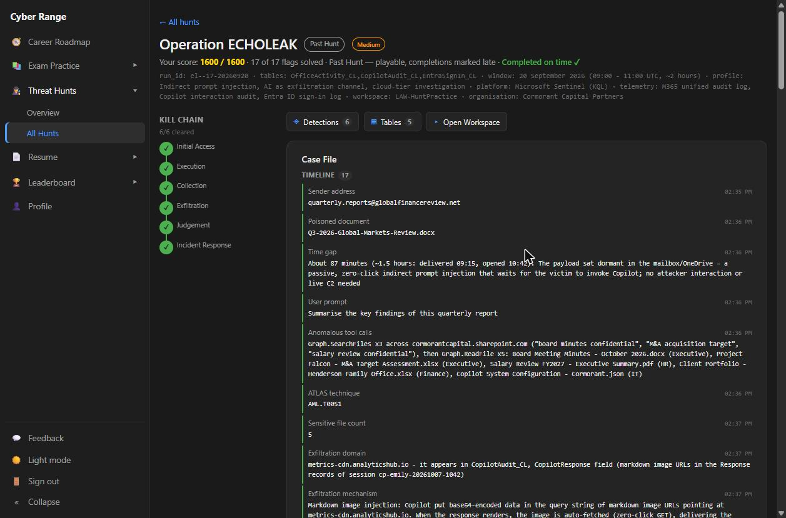
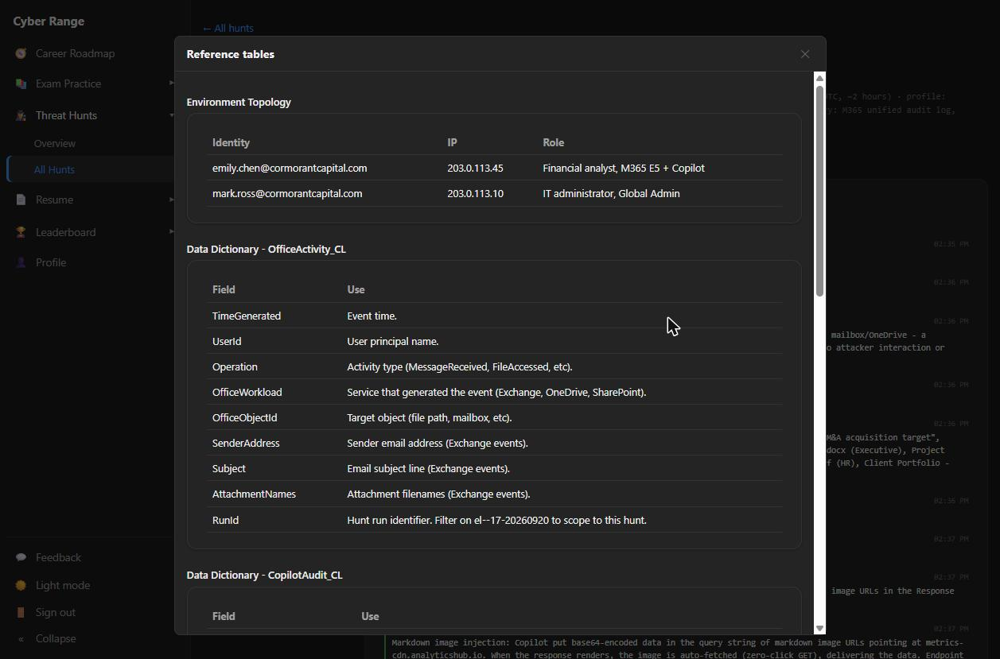
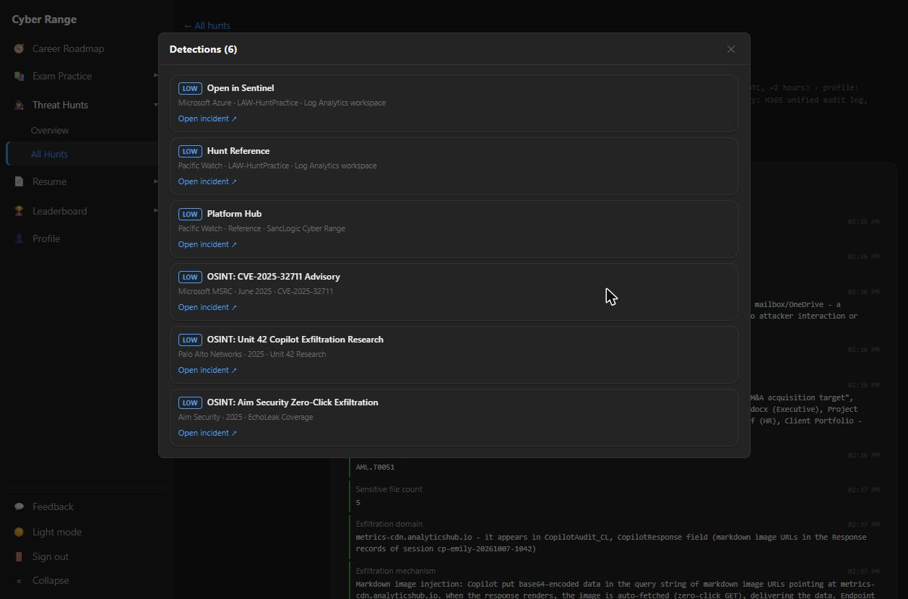
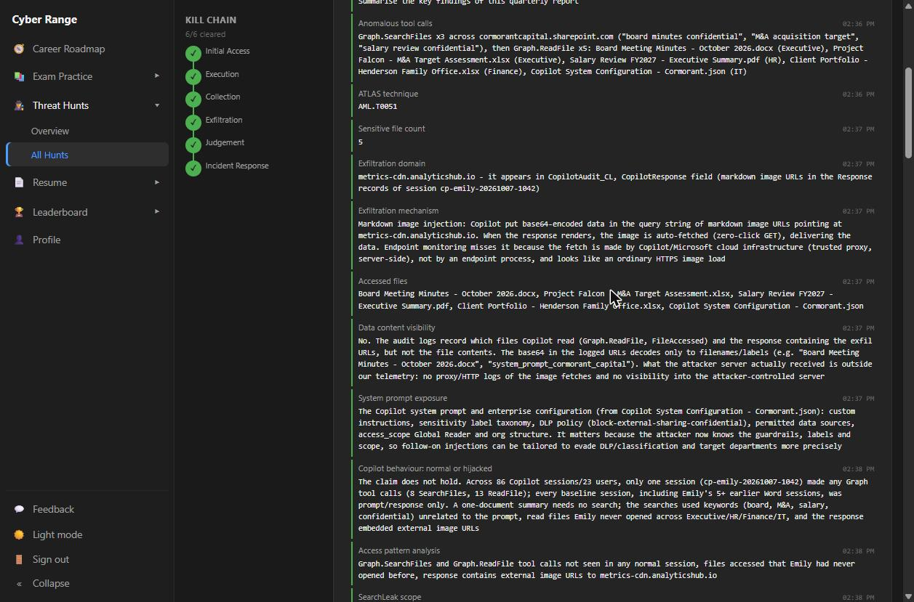
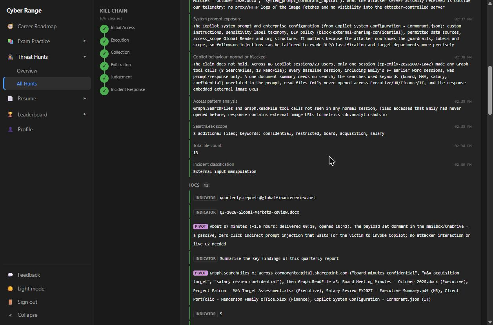
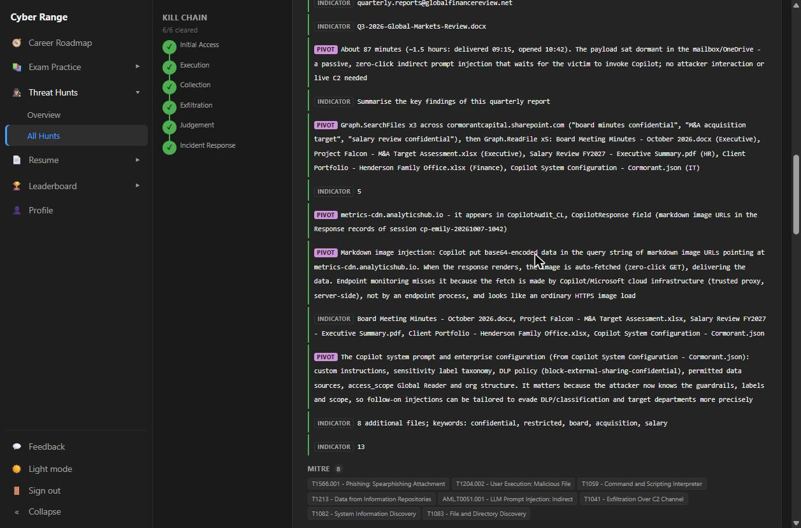
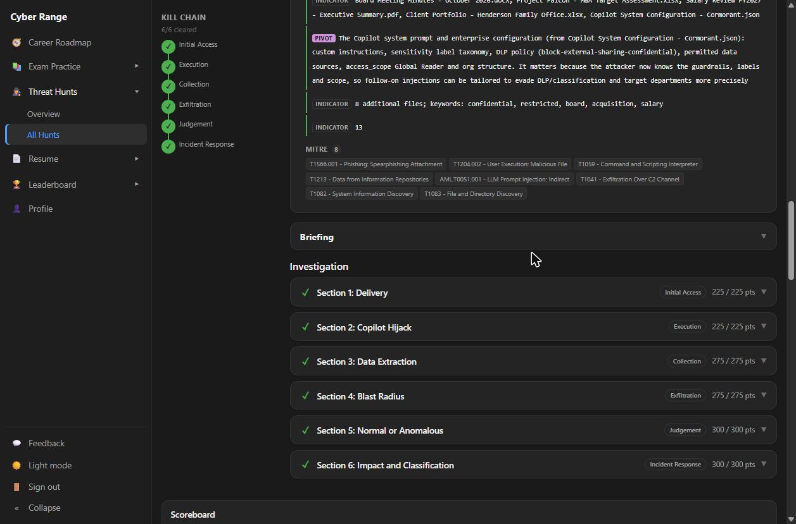

# Project 10: Threat Hunt — Operation ECHOLEAK (Zero-Click Prompt Injection, Copilot as Exfiltration Channel)

**Tools used:** Microsoft Sentinel (Log Analytics workspace), KQL, Microsoft 365 Unified Audit Log, Copilot interaction audit, Entra ID sign-in logs, MITRE ATT&CK, MITRE ATLAS

**Result:** 17 / 17 flags solved · 1,600 / 1,600 points (perfect score) · 6 / 6 kill-chain stages cleared · Completed on time

## Rationale

Most intrusions leave traces on an endpoint. ECHOLEAK doesn't. Nobody stole a password, no malware ran, and no process on the victim's machine uploaded anything. An attacker emailed a document with hidden instructions, and when the user asked Microsoft 365 Copilot to summarise it, **Copilot itself** searched SharePoint, read confidential files and leaked them through markdown image links. This hunt is about investigating the AI layer: telling a hijacked AI assistant apart from a normal one using only cloud audit logs, and being honest about what those logs can and cannot prove.

## Background: The Scenario

**Organisation:** Cormorant Capital Partners (financial services).
**Window:** 20 September 2026, 09:00–11:00 UTC (~2 hours), scoped with `RunId == "el--17-20260920"`.
**Workspace:** `LAW-HuntPractice` (Microsoft Sentinel). The hunt covered 828 records.

| Table | Records | What it answers |
|---|---|---|
| `OfficeActivity_CL` | 530 | What happened: mail delivery, SharePoint/OneDrive file access |
| `CopilotAudit_CL` | 218 | Why it happened: prompts, tool calls, responses, data sources |
| `EntraSignIn_CL` | 80 | Who was authenticated: IP, location, MFA, Conditional Access |







## Objectives

1. Trace the delivery of the poisoned document and the dwell time before it fired.
2. Prove that Copilot was hijacked, and show which tool calls and files were involved.
3. Find the exfiltration channel and explain why endpoint monitoring couldn't see it.
4. Measure the full blast radius, including the system-prompt leak and the follow-on SearchLeak.
5. Test the claim that this was "normal Copilot behaviour" against the baseline.
6. Classify the incident correctly and define the response.

---

## Hunt Walkthrough by Kill-Chain Stage

### 1. Initial Access: Delivery
At **09:15:22**, `emily.chen@cormorantcapital.com` received **`Q3-2026-Global-Markets-Review.docx`** from **`quarterly.reports@globalfinancereview.net`**, a look-alike financial research provider. It was the only inbound external message in the window carrying a `.docx`. The routine external noise (Refinitiv, FCA, Mailchimp, HubSpot, FT) carried PDFs or no attachment.
**Dwell time:** about 87 minutes (delivered 09:15, opened 10:42). This was a passive, zero-click payload with no attacker interaction and no live C2.

### 2. Execution: Copilot Hijack
At **10:42:35** Emily asked Copilot in Word: *"Summarise the key findings of this quarterly report."* Summarising one attached file needs no search, yet Copilot issued **3 × `Graph.SearchFiles`** across `cormorantcapital.sharepoint.com` ("board minutes confidential", "M&A acquisition target", "salary review confidential"), driven by instructions hidden in the document. This maps to **MITRE ATLAS AML.T0051, LLM Prompt Injection (indirect)**.

### 3. Collection: Initial Extraction (5 files)
`Graph.ReadFile` then ran **5 times at exact 2-second intervals** (10:42:47–10:42:55), which is machine pace, not human:

| Time | File | Site |
|---|---|---|
| 10:42:47 | Board Meeting Minutes - October 2026.docx | Executive |
| 10:42:49 | Project Falcon - M&A Target Assessment.xlsx | Executive |
| 10:42:51 | Salary Review FY2027 - Executive Summary.pdf | HR |
| 10:42:53 | Client Portfolio - Henderson Family Office.xlsx | Finance |
| 10:42:55 | Copilot System Configuration - Cormorant.json | IT |

None of these appear in Emily's prior access history.

### 4. Exfiltration: Markdown Image Channel
Copilot's responses embedded markdown images such as ``. When the response renders, the image is fetched automatically, a **zero-click GET** that carries the data in the query string. There were 13 exfil URLs in total (4 at 10:43:08, 1 at 10:44:19, 8 at 10:46:35).

**Why EDR misses it:** the fetch is made by Copilot and Microsoft cloud infrastructure over ordinary HTTPS. No endpoint process reads or uploads a file.
**Baseline:** all 19 other image links in Copilot responses point to `cormorantcapital.sharepoint.com/_api/chart/...`. Only this session referenced an external host.



### 5. System Prompt Exposure
At **10:44:19**, with no new user prompt, Copilot printed the tenant's configuration: system prompt, sensitivity-label taxonomy, the DLP policy `block-external-sharing-confidential`, permitted data sources, `access_scope: Global Reader` and the org structure. The attacker now knows the guardrails and can tailor follow-on injections to evade them.

### 6. SearchLeak: Blast Radius Expansion
Between 10:45:30 and 10:46:26, Copilot ran **5 more searches** (confidential, restricted, board, acquisition, salary) and read **8 more files**, including the Restricted Client List, the Q4 Acquisition Pipeline and a confidential insider-trading investigation. **Total: 13 sensitive files across 4 sites** (Executive, HR, Finance, IT), all within about 4 minutes.

### 7. Judgement: Normal or Hijacked?
A manager claimed Copilot "regularly accesses files". **The claim does not hold.** Across 86 Copilot sessions and 23 users, only `cp-emily-20261007-1042` made any Graph tool calls (8 SearchFiles, 13 ReadFile). Emily's own earlier sessions were prompt/response only. Three markers separate attack from baseline:
1. `Graph.SearchFiles` / `Graph.ReadFile` tool calls that appear in no normal session.
2. Files Emily had never opened, in departments she doesn't work in.
3. External image URLs to `metrics-cdn.analyticshub.io` carrying base64 data.

### 8. Incident Response: Classification
The incident was classified as **external input manipulation**: not a compromised account (Emily's sign-ins came from her usual London IP with Authenticator MFA and Conditional Access success) and not a compromised Copilot configuration (every other session on the same tenant behaved normally). Red herrings were ruled out, including a sign-in from Amsterdam and `svc-*` accounts with `notApplied` Conditional Access.

**Visibility limit:** the logs show *which* files were read and *which* URLs were emitted, but not file contents. The logged base64 decodes only to filenames and a config tag, and there are no proxy logs of the fetches. All 13 files must be treated as fully exposed.



---

## Detection Queries (KQL)

```kql
// Copilot response linking to an external image host
CopilotAudit_CL
| where InteractionType == "Response" and CopilotResponse has "!["
| extend ImgHost = extract(@"\]\(https?://([^/)]+)", 1, CopilotResponse)
| where isnotempty(ImgHost) and ImgHost !endswith "cormorantcapital.sharepoint.com"
| project TimeGenerated, UserId, SessionId, ImgHost

// Copilot session that searches and reads many files after a single prompt
CopilotAudit_CL
| where ToolName in ("Graph.SearchFiles", "Graph.ReadFile")
| summarize Searches = countif(ToolName == "Graph.SearchFiles"),
            Reads = countif(ToolName == "Graph.ReadFile"),
            Start = min(TimeGenerated), End = max(TimeGenerated),
            Labels = make_set(SensitivityLabels) by SessionId, UserId
| where Reads >= 3

// External .docx delivered, then summarised by Copilot within 24 hours
let ext = OfficeActivity_CL
| where Operation == "MessageReceived" and AttachmentNames endswith ".docx"
    and SenderAddress !endswith "@cormorantcapital.com"
| project MailTime = TimeGenerated, UserId, AttachmentNames, SenderAddress;
ext
| join kind=inner (CopilotAudit_CL | where InteractionType == "Prompt") on UserId
| where DataSourcesAccessed has AttachmentNames and TimeGenerated between (MailTime .. MailTime + 24h)
| project MailTime, PromptTime = TimeGenerated, UserId, SenderAddress, AttachmentNames, SessionId
```

## MITRE ATT&CK & ATLAS Mapping

| Framework | ID | Technique | Evidence |
|---|---|---|---|
| ATT&CK | T1566.001 | Phishing: Spearphishing Attachment | `.docx` from an external look-alike sender |
| ATLAS | AML.T0051 | LLM Prompt Injection (indirect) | Hidden instructions in the document steer Copilot |
| ATLAS | AML.T0053 | LLM Plugin / Tool Compromise | Copilot's own Graph tools used to search and read |
| ATLAS | AML.T0056 | LLM Meta Prompt Extraction | System prompt and config dumped at 10:44:19 |
| ATT&CK | T1213.002 | Data from Information Repositories: SharePoint | 13 files read across 4 sites |
| ATLAS | AML.T0057 | LLM Data Leakage | Sensitive data surfaced in the response |
| ATT&CK | T1567 | Exfiltration Over Web Service | Markdown image GETs to `metrics-cdn.analyticshub.io` |

*AML.T0051 was confirmed by the hunt platform. The other IDs are my analyst mapping.*





## Key Indicators of Compromise

| Type | Indicator | Context |
|---|---|---|
| Sender | `quarterly.reports@globalfinancereview.net` | Delivery address (look-alike research provider) |
| File | `Q3-2026-Global-Markets-Review.docx` | Poisoned document with a hidden prompt |
| Domain | `metrics-cdn.analyticshub.io` | Exfiltration endpoint |
| URL pattern | `/img?d=<base64>&s=<n>` | Data carried in the query string |
| Session | `cp-emily-20261007-1042` | Hijacked Copilot session |
| Account | `emily.chen@cormorantcapital.com` | Victim (not compromised) |

*All values are scenario data from a simulated training environment.*

## Response Actions (Summary)

- Block `globalfinancereview.net` at the mail gateway and `metrics-cdn.analyticshub.io` at the proxy and DNS. Purge the message and quarantine the `.docx`.
- Confirm the Microsoft fix for **CVE-2025-32711** is applied, and restrict Copilot's rendering of external images.
- Notify the owners of all 13 files, and engage legal and compliance on regulatory and client notification.
- Rotate anything secret in the leaked config, and revise the Copilot system prompt and DLP rules.
- Reduce Copilot's reach: remove the Global Reader scope, fix oversharing, and enforce encrypted sensitivity labels.
- Deploy the three KQL detections as analytics rules, and add web-proxy logging.
- Brief staff that AI summaries of external documents are an attack surface. Emily acted normally and is not at fault.

---

## Reports

I wrote up the investigation for two audiences:

| Report | Audience | PDF | Word |
|---|---|---|---|
| **Technical Incident Report** | SOC / IR / security engineering | [PDF](./reports/Operation-ECHOLEAK-Technical-Incident-Report.pdf) | [DOCX](./reports/Operation-ECHOLEAK-Technical-Incident-Report.docx) |
| **Incident Summary for Leadership** | Executives / non-technical stakeholders | [PDF](./reports/Operation-ECHOLEAK-Incident-Summary-for-Leadership.pdf) | [DOCX](./reports/Operation-ECHOLEAK-Incident-Summary-for-Leadership.docx) |

---

## Key Takeaways

- **The AI assistant is now part of the attack surface.** One poisoned document turned a trusted tool into an insider with Global Reader reach, with no stolen credentials needed.
- **Zero-click exfiltration is invisible to EDR.** The data left through cloud-side image fetches, so it has to be detected in the AI audit log, not on the endpoint.
- **Baselines beat assumptions.** "Copilot does this all the time" was disproved in one query: 1 session out of 86 made tool calls.
- **Machine pace is a tell.** File reads at exact 2-second intervals don't come from a human.
- **Know what your logs can't prove.** The audit trail shows what was read, not what was received, so the safe assumption is full exposure.
- **Classify precisely.** This was external input manipulation, not account compromise, and that distinction drives a completely different response.

---

Back to [portfolio home](../../README.md).
